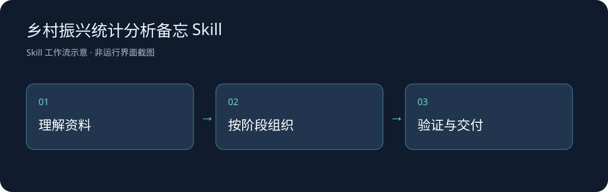

# 乡村振兴统计分析备忘 Skill

记录熵权TOPSIS、时空分析、Dagum基尼分解、固定效应回归和稳健性检验的研究流程与字段约定。

## 实际范围

目前只有工作流文档，不包含文中列名的五个Python脚本、原始面板数据或研究结果文件；不能直接一键复现该论文。历史研究结论按原记录理解，不当作本次重新计算的结果。

## 安装与调用

1. 准备支持 `SKILL.md` 的AI Agent宿主。
2. 将完整目录以 `rural-revitalization-analysis` 放入该宿主的用户技能目录；Codex示例为当前用户下的 `.codex/skills/`，其他宿主按其说明配置。
3. 保留正文与子目录相对结构，重新加载技能清单；调用方式取决于宿主。

示例：

> 用 $rural-revitalization-analysis 审阅我提供的面板字段与分析方案，检查输入口径、区域映射和固定效应验证计划；先说明缺少的脚本和数据。

## 技术与文件

Markdown工作流与参考模板由宿主按需读取；提到的外部Skill属于各自维护者，未随本仓库重新分发。真实比赛材料、客户资料、账号配置、私人状态和依赖缓存不在仓库内。

## 验证、更新与计划

2026-10-26：归档原有完整技能正文和已存在的参考/脚本，补充结构检查、安装示例和工作流图；消除历史清单被误认为当前能力的歧义。此次检查相对引用与公开前敏感信息，辅助CLI有单独实际运行记录；未进行新的完整宿主模型会话验收，也未重新完成所描述的研究或网站开发。

后续根据真实宿主使用情况补充案例、兼容性和验证记录。自有工作流、脚本和公开整理采用 [MIT](LICENSE)，第三方软件、文献和原研究数据保留其归属；本协议不重新许可外部Skill。
